# TMNT Frogger - Technical Overview 🔧

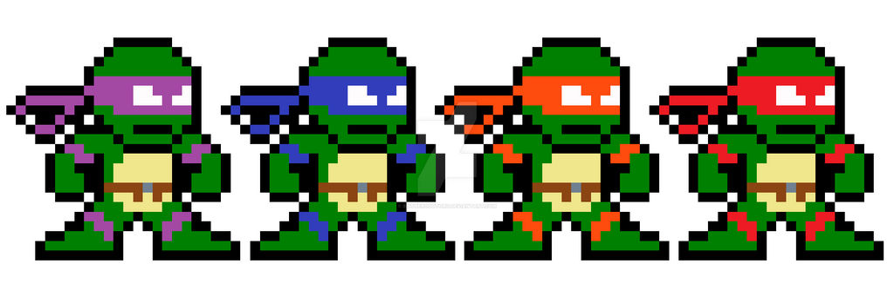

## Project Overview

This Android application is a complete recreation of the classic Frogger arcade game, themed with Teenage Mutant Ninja Turtles characters. Built entirely in Java using the Android SDK, it demonstrates advanced mobile game development concepts without relying on external game engines.

## 📋 Technical Specifications

### Development Environment
- **Language**: Java
- **Platform**: Android SDK
- **Minimum API Level**: 27 (Android 8.1)
- **Target API Level**: 32 (Android 12L)
- **Build System**: Gradle
- **IDE**: Android Studio

### Dependencies
```gradle
implementation 'androidx.appcompat:appcompat:1.4.0'
implementation 'com.google.android.material:material:1.4.0'
implementation 'androidx.constraintlayout:constraintlayout:2.1.2'
```

## 🏗️ Architecture Overview

### Single Activity Architecture
The application follows a single-activity pattern with multiple layout views managed through `setContentView()`:

```
MainActivity.java (2000+ lines)
├── Main Menu (activity_main.xml)
├── Configuration Screen (configuration.xml)
├── Game Screen (activity_game_screen.xml)
├── Game Over Screen (game_over.xml)
└── Victory Screen (game_win.xml)
```

### Core Components

#### 1. MainActivity.java
The central controller containing all game logic:

**Key Constants & Configuration:**
```java
// Character Types
private static final int RAPHAEL = 1;
private static final int DONATELLO = 2;
private static final int LEONARDO = 3;
private static final int MICHELANGELO = 4;

// Difficulty Levels
private static final int EASY = 1;    // 5 lives
private static final int MEDIUM = 2;  // 3 lives
private static final int HARD = 3;    // 1 life

// Lane Configuration
private static final int Y_LANE1 = 1600;  // Bottom road lane
private static final int Y_LANE2 = 1480;
private static final int Y_LANE3 = 1330;
private static final int Y_LANE4 = 1180;
private static final int Y_LANE5 = 1030;   // Top road lane

// River Lanes
private static final int RIVER_Y_LANE1 = 720;
private static final int RIVER_Y_LANE2 = 590;
private static final int RIVER_Y_LANE3 = 460;
private static final int RIVER_Y_LANE4 = 330;
```

#### 2. Game State Management
**Game Variables:**
- `spriteX`, `spriteY`: Player position coordinates
- `lives`: Current player lives (1-5 based on difficulty)
- `score`: Current game score
- `selectedCharacter`: Chosen TMNT character
- `selectedDifficulty`: Game difficulty level

#### 3. Timer-Based Animation System
```java
private Timer timer = new Timer();
private Timer vehicleTimer = new Timer();
private Handler handler = new Handler();
private Handler vehicleHandle = new Handler();
```

## 🎮 Core Game Systems

### 1. Player Movement System
**Touch-Based Controls:**
```java
@Override
public boolean onTouch(View view, MotionEvent motionEvent) {
    if (motionEvent.getAction() == MotionEvent.ACTION_DOWN) {
        switch (view.getId()) {
            case R.id.upButton: actionUp = true; break;
            case R.id.downButton: actionDown = true; break;
            case R.id.leftButton: actionLeft = true; break;
            case R.id.rightButton: actionRight = true; break;
        }
    } else {
        // Reset all actions on release
        actionUp = actionDown = actionLeft = actionRight = false;
    }
    return true;
}
```

**Movement Constraints:**
- Vertical: Y-axis bounds from 180 to 1870 pixels
- Horizontal: X-axis bounds from 2 to 970 pixels
- Movement speed: 4 pixels per frame at 10ms intervals

### 2. Vehicle Management System

**Dynamic Vehicle Creation:**
```java
public void moveObject(View view, int id, int speed, int xPos, int yPos, boolean vehicleorlog) {
    ImageView vehicle = findViewById(id);
    vehicle.setX(xPos);
    vehicle.setY(yPos);
    
    vehicleTimer.scheduleAtFixedRate(new TimerTask() {
        @Override
        public void run() {
            vehicleHandle.post(() -> {
                float curTruckX = vehicle.getX();
                if (curTruckX < 1351 && curTruckX > -501) {
                    vehicle.setX(curTruckX + speed);
                    if (vehicleorlog == VEHICLE) {
                        checkEachVehicle(curTruckX + speed, yPos, id, view);
                    }
                } else {
                    // Reset position for continuous loop
                    vehicle.setX(speed > 0 ? -500 : 1350);
                }
            });
        }
    }, 0, 6); // 6ms intervals for smooth movement
}
```

**Vehicle Configuration (5 Road Lanes):**
- **Lane 1**: Cars moving left at speed -1
- **Lane 2**: Bus, construction truck, pickup truck moving right at speed +1  
- **Lane 3**: Trash truck, car moving left at speed -2
- **Lane 4**: Pickup truck, government car moving right at speed +3
- **Lane 5**: Police cars moving left at speed -3

### 3. Collision Detection System

**Precise Boundary Checking:**
```java
public void checkEachVehicle(float carX, float carY, int vehicleID, View view) {
    // Player boundaries
    float spriteTopY = spriteY + 27;
    float spriteBottomY = spriteY - 27;
    float spriteRightX = spriteX + 20;
    float spriteLeftX = spriteX - 20;

    // Vehicle boundaries  
    float vehicleTopY = carY + 20;
    float vehicleBottomY = carY - 20;
    float vehicleRightX = carX + 35;
    float vehicleLeftX = carX - 35;

    if (checkVehicleBounds(spriteLeftX, vehicleRightX, spriteRightX, 
                          vehicleLeftX, spriteTopY, vehicleBottomY, spriteBottomY)) {
        loseLife(view);
    }
}

public Boolean checkVehicleBounds(float slx, float vrx, float srx, float vlx, 
                                 float sty, float vby, float sby) {
    return (slx < vrx && srx > vlx) && (sty > vby && sby < vehicleTopY);
}
```

### 4. Scoring System

**Progressive Scoring Logic:**
```java
public void incScore(View view, float spriteY) {
    if (spriteY < maxYAxis) {
        ImageView water = findViewById(R.id.water);
        int maxWater = water.getTop();
        int minWater = water.getBottom();
        
        if (checkIfWaterLower(spriteY, minWater) && checkIfWaterUpper(spriteY, maxWater)) {
            score = score + 2;  // Bonus points in water
        } else {
            score++;  // Standard forward progress
        }
        maxYAxis = spriteY;
        scoreText.setText("Score: " + score);
    }
}
```

### 5. Life Management System

**Life Loss Handling:**
```java
public void loseLife(View view) {
    lives--;
    if (lives <= 0) {
        // Game Over
        timer.cancel();
        vehicleTimer.cancel();
        setContentView(R.layout.game_over);
        TextView gameOver = findViewById(R.id.scoreFinalText);
        gameOver.setText("Final Score: " + score);
        // Reset game state
        resetGameState();
    } else {
        // Reset position, maintain lives
        score = 0;
        maxYAxis = 1870;
        resetPlayerPosition();
        updateLivesDisplay();
    }
}
```

## 🎨 Asset Management

### Drawable Resources (32 Assets)
**Character Sprites:**
- 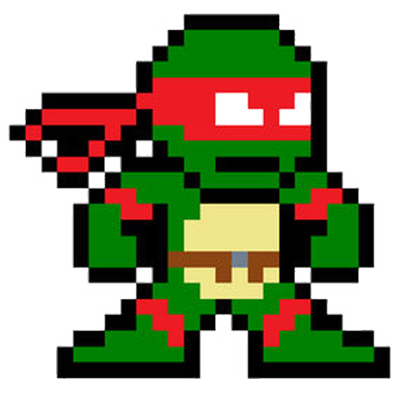 `raphael55.png` (55x55px)
- 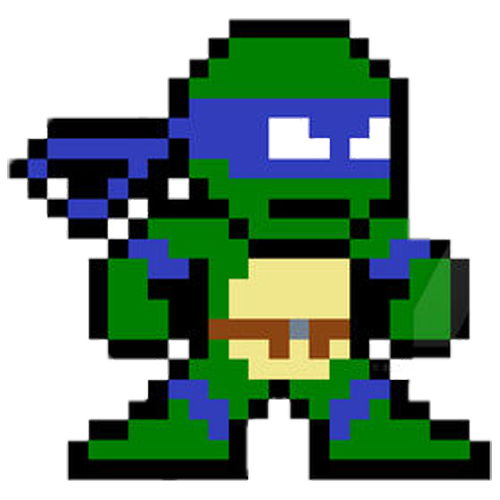 `leonardo.png`
- 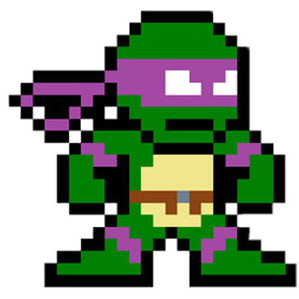 `donatello.png` 
- 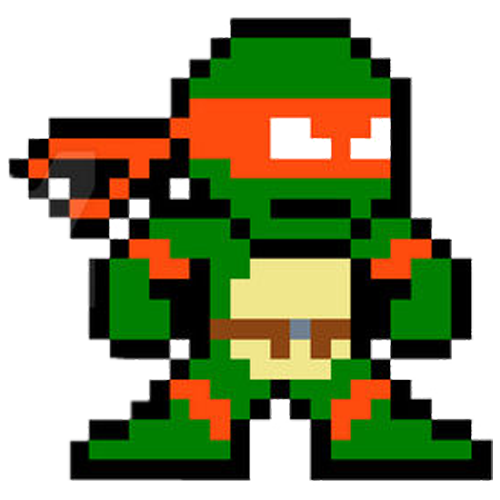 `michelangelo.png`

**Vehicle Assets:**
- 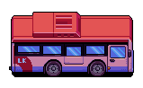 `bus.png` - Large public transport
- 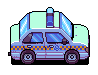 `policecar.png` - Fast police vehicle
- 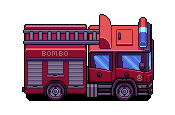 `firetruck.png` - Emergency vehicle
- 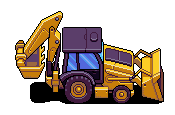 `constructiontruck.png`
- Multiple car variants: `cara.png`, `carb.png`, `carc.png`, `card.png`, `care.png`, `carf.png`
- Pickup trucks: `pickuptrucka.png`, `pickuptruckb.png`
- Specialty vehicles: `govtcar.png`, `ambulance.png`, `trashtruck.png`

**Environment Assets:**
- 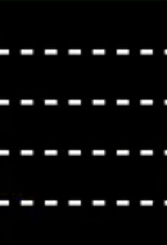 `road.png` - Road texture
-  `water.png` - River sections
-  `safe_area.png` - Safe zones
-  `goal.png` - Victory areas
- 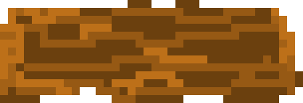 `log.png` - Floating platforms

**UI Controls:**
-  `upbutton.png`
-  `downbutton.png`  
-  `leftbutton.png`
-  `rightbutton.png`
-  `heart.png` - Lives indicator

## 🖥️ UI Layout System

### 1. Main Menu (activity_main.xml)
**Layout Structure:**
```xml
<androidx.constraintlayout.widget.ConstraintLayout>
    <TextView android:text="@string/frogger" android:textSize="48sp" />
    <ImageView app:srcCompat="@drawable/tmnt" />
    <Button android:onClick="startConfig" android:text="@string/start" />
</androidx.constraintlayout.widget.ConstraintLayout>
```

### 2. Configuration Screen (configuration.xml)
**User Input Elements:**
- Username entry with validation
- Difficulty selection (Easy/Medium/Hard)
- Character selection with preview images
- Form validation before game start

### 3. Game Screen (activity_game_screen.xml)
**Complex Layout (480+ lines):**
- **HUD Elements**: Player name, score, lives display
- **Road Layers**: 3 road sections with proper overlap
- **Water Sections**: 2 water areas with logs
- **Safe Areas**: 5 safe zone strips
- **Goal Areas**: 5 goal targets at top
- **Vehicle Objects**: 15+ dynamic vehicle ImageViews
- **Log Objects**: 8 floating log platforms
- **Control Pad**: 4 directional buttons
- **Player Sprite**: Dynamic character representation

**Coordinate System:**
- Screen dimensions: ~1080px width × 830px height
- Y-coordinates: 0 (top) to 1870 (bottom)
- Lane spacing: ~130px between road lanes
- Vehicle slot positions: X_SLOT0 (0px) to X_SLOT10 (1200px)

## ⚡ Performance Considerations

### Timer Management
**Dual Timer System:**
- **Main Game Timer**: 10ms intervals for player movement
- **Vehicle Timer**: 6ms intervals for vehicle animation
- **Proper Cleanup**: Timers cancelled on game state changes

### Memory Management
**Resource Optimization:**
- Reuse of Timer objects after cancellation
- Efficient ImageView recycling for vehicles
- Minimal object creation in animation loops

### Collision Optimization
**Selective Checking:**
- Collision detection only during active gameplay
- Early exit conditions for game over states
- Boundary pre-calculations to reduce computation

## 🔄 Game Flow State Machine

```
[Main Menu] 
    ↓ (Start Button)
[Configuration]
    ↓ (Username + Difficulty + Character)
[Game Active]
    ├── [Life Lost] → [Reset Position] → [Continue]
    ├── [All Lives Lost] → [Game Over Screen]
    └── [Reach Goal] → [Victory Screen]
[End Screens]
    ├── [Exit] → [App Close]
    └── [Restart] → [Configuration]
```

## 🐛 Known Technical Limitations

1. **River Mechanics**: Log collision detection is implemented but commented out
2. **Water Hazards**: Basic water collision detection present but not fully utilized
3. **Character Classes**: Empty `Player.java`, `Vehicle.java`, `GamePad.java` classes suggest planned OOP refactoring
4. **Memory Leaks**: Timer management could be improved with proper lifecycle handling

## 🔧 Development Best Practices Demonstrated

### Code Organization
- **Constants Management**: Centralized game configuration
- **Method Separation**: Distinct methods for each game system
- **Event Handling**: Proper touch listener implementation
- **State Management**: Consistent game state updates

### Android Development
- **Constraint Layouts**: Modern responsive UI design
- **Resource Management**: Proper drawable and string resources
- **Activity Lifecycle**: Appropriate use of `onCreate()` and state management
- **View Binding**: Efficient findViewById usage patterns

### Game Development
- **Frame-Rate Management**: Consistent timing with Handler/Timer
- **Collision Systems**: Precise boundary-based detection
- **Animation Loops**: Smooth continuous movement
- **Score Systems**: Progressive difficulty and bonus mechanics

## 📈 Potential Enhancements

### Technical Improvements
1. **Object-Oriented Refactoring**: Implement Vehicle and Player classes
2. **Fragment Architecture**: Replace multiple layouts with fragments
3. **Custom Views**: Create specialized game components
4. **Sound System**: Add audio feedback and background music
5. **Database Integration**: High score persistence with Room database
6. **Multiplayer Support**: Network-based multiplayer functionality

### Game Features
1. **Power-ups**: Special abilities and temporary invincibility
2. **Level Progression**: Multiple maps with increasing difficulty
3. **Achievement System**: Unlock rewards and challenges
4. **Customization**: Player unlockable skins and themes
5. **Analytics**: Game telemetry and performance tracking

---

This technical overview demonstrates a comprehensive understanding of Android game development, showcasing both fundamental mobile app development skills and game programming concepts implemented without external frameworks.
